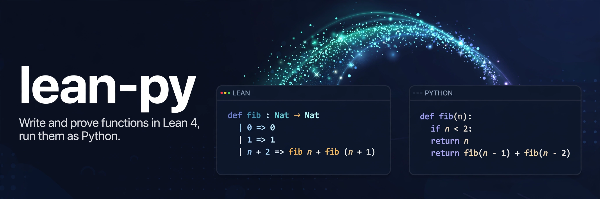

<p align="center">
  
</p>

<p align="center"><strong>Write and prove functions in Lean 4, run them as Python</strong></p>

<p align="center">
  <a href="https://pypi.org/project/lean-python/"></a>
  <a href="https://github.com/conao3/lean-py/actions/workflows/ci.yml"></a>
  <a href="https://github.com/conao3/lean-py/blob/master/LICENSE"></a>
  <a href="https://github.com/conao3/lean-py/blob/master/pyproject.toml">=3.12"></a>
  <a href="https://github.com/conao3/lean-py/blob/master/lean-toolchain"></a>
  <a href="https://github.com/conao3/lean-py/stargazers"></a>
</p>

<p align="center">
  <a href="#install">Install</a> ·
  <a href="#lean-blocks">Lean blocks</a> ·
  <a href="#values">Values</a> ·
  <a href="#verifying-python-functions">Verifying Python functions</a> ·
  <a href="#examples">Examples</a> ·
  <a href="#performance">Performance</a> ·
  <a href="https://pypi.org/project/lean-python/">PyPI</a>
</p>

# lean-py

lean-py lets you write functions in Lean 4, prove theorems about them, and call them from Python
with pydantic models as arguments and results. The PyPI distribution is `lean-python`; you import
it as `lean_python`.

```python
from pydantic import BaseModel, Field
from lean_python import lean


class LineItem(BaseModel):
    sku: str
    qty: int = Field(ge=1)
    unitPrice: int = Field(ge=0)


pricing = lean("pricing", r"""
inductive Discount where
  | none
  | percent (p : Nat) (h : p ≤ 100)
  | fixed (amount : Nat)

def subtotal (items : List LineItem) : Nat :=
  items.foldl (fun acc i => acc + i.qty * i.unitPrice) 0

def total (items : List LineItem) (d : Discount) : Nat :=
  match d with
  | .none => subtotal items
  | .percent p _ => subtotal items - subtotal items * p / 100
  | .fixed a => subtotal items - a

theorem total_le (items : List LineItem) (d : Discount) : total items d ≤ subtotal items := by
  unfold total; split <;> omega
""", models=[LineItem])

items = [LineItem(sku="a", qty=2, unitPrice=100)]
pricing.total(items, pricing.Discount.percent(p=10))  # 180
pricing.Discount.percent(p=150)                       # pydantic.ValidationError: p: Input should be less than or equal to 100
```

- `lean-py sync` checks the proofs with Lake and compiles the Lean code from Lean's IR to plain
  Python. It writes the generated modules to `<package>/_lean/`, and they ship with your package.
  To run them you need the `lean-python` wheel and pydantic. You do not need Lean.
- The generated Python computes what the C backend computes. A diff test runs the same Lean
  programs natively and as Python and compares the output byte for byte. The generated code keeps
  reference counting, so `Array` updates happen in place as in C.
- Lean structures and inductive types become pydantic models. A proof field (`h : p ≤ 100`) becomes
  a validator that runs a decision procedure compiled from the proposition, so every value that
  reaches Lean satisfies the invariants the proofs rely on. A comparison with a constant also becomes
  an annotated-types constraint (`Le(100)`) that pydantic-core checks and the JSON Schema shows. The
  JSON of the models is the JSON of Lean's `deriving ToJson, FromJson`.
- Lean code can use your own pydantic models (`models=[...]`). Their field constraints
  (`ge`, `gt`, `le`, `lt`, `min_length`, `max_length`) become proof fields that Lean proofs may assume.
- The models work wherever pydantic does: `TypeAdapter`, `model_validate_json`, JSON Schema, FastAPI
  request and response types.
- `@model` binds a plain Python function to Lean specifications. `lean-py check` translates the
  function to Lean and judges your proofs ([Verifying Python functions](#verifying-python-functions)).

## Install

The Python package and the Lean CLI:

```sh
uv add lean-python                            # the runtime, lean(), lean-py sync
nix profile install github:conao3/lean-py     # the Lean CLI `lean-python`
```

`lean-py sync` also needs `lake` and the Lean toolchain of `lean-toolchain` (v4.35.0) on `PATH`.

## Lean blocks

`lean(name, source, *, imports=(), uses=(), models=())` defines a Lean block of the calling module,
which must belong to a package. The block's definitions live in the namespace
`LeanPythonEmbed.<module>.<name>`. The returned module exposes them under their names relative to it
(`Discount.percent`, `total`).

```sh
lean-py sync --package src/myapp
```

`lean-py sync` imports every module of the package, writes each block to a Lake workspace in
`.lean-python/workspace/`, builds it, and generates `src/myapp/_lean/<module>__<name>.py` and
`src/myapp/_lean/blocks.json`. Lean errors point at the Python file:

```
lean-py: src/myapp/m.py:6: error: (lean block m, Lean 4:28) Tactic `rfl` failed: ...
```

Add `.lean-python/` to `.gitignore` and commit `<package>/_lean/`.

At run time `lean(...)` compares a hash of the block (its source, imports, uses, the Lean structures
of its models and the generator version) with `blocks.json`. If the block changed since the last
sync, it raises `LeanBlockStale`. With `LEAN_PYTHON_AUTO_SYNC=1` it runs `lean-py sync` instead.

- `imports=["Std.Data.HashMap"]`: Lean modules to import.
- `uses=["geometry"]`: other blocks of the module (or `"pkg.mod:name"`) to import and open. The
  block shares their types and does not generate them again.
- `models=[LineItem]`: pydantic models available as Lean structures (below).

## Values

| Lean | Python |
|---|---|
| `Nat` | `int` (`lean_python.types.Nat` = `Annotated[int, Ge(0)]`) |
| `Int` | `int` |
| `UInt8` … `UInt64`, `USize`, `Int8` … `Int64` | `int` with the range as `Ge`/`Le` |
| `Fin n` | `Annotated[int, Ge(0), Lt(n)]` |
| `Bool` | `bool` |
| `Char` | `str` of one character |
| `String` | `str` |
| `Float`, `Float32` | `float` |
| `Unit` | `None` |
| `Option α` | `α \| None` |
| `List α`, `Array α` | `list[α]` |
| `α × β` | `tuple[α, β]` |
| `{x : α // p x}` | `Annotated[α, AfterValidator(p)]` |
| structure | a frozen, strict pydantic model |
| inductive type, constructors without arguments | `enum.StrEnum` |
| other inductive type | a model per constructor, subclasses of the type's class |
| `IO α` | `α`; an `IO.Error` is raised as `LeanIOError` (an `OSError`) |

The generated functions check arguments while they convert them: `pub.double(-1)` raises
`ValidationError` with the location of the bad value. Constants are functions without arguments
(`answer()`).

Constructors and structures take keyword arguments (`Shape.rect(width=1, height=2)`); unnamed
constructor arguments are `a0`, `a1`, …. Inductive values work with `match`:

```python
match shape:
    case geometry.Shape.rect(width=w, height=h):
        ...
```

### JSON

The JSON of a generated model is the JSON of Lean's derived `ToJson`: a structure is an object, a
constructor without arguments is its name (`"dot"`), a constructor with named arguments is
`{"rect": {"width": 1, "height": 2}}`, with unnamed arguments `{"num": 7}` or `{"pair": [1, "x"]}`.
`tests/test_json.py` compares the generated models with a native Lean program that prints `toJson`.

### Your pydantic models in Lean

`models=[LineItem]` writes a Lean structure for each model (and the models its fields use) to the
namespace `LeanPythonModels.<python module>`, and the block opens that namespace:

```lean
structure LineItem where
  sku : String
  qty : Nat
  qty_ge : 1 ≤ qty
  unitPrice : Nat
```

`int` with a lower bound of at least 0 becomes `Nat`; the other bounds and `min_length`/`max_length`
become proof fields. Field types:

- `int`, `bool`, `str`, `float`, `list[T]`, `tuple[...]`, `T | None`, other models
- enums: an inductive type `LeanPythonModels.<module>.<Enum>` with a constructor per member
- `Literal["a", "b"]`: `LeanPythonLiterals.<module>.<Model>_<field>`
- unions of models: `LeanPythonUnions.<module>.<Model>_<field>`, a constructor per model holding it
  as `val`

Lean proofs cannot assume `multiple_of`, `pattern` or validators; the structure's docstring lists
them. Generated functions take and return your classes. Values that skipped validation
(`model_construct`) go through validation again on the way to Lean.

## Verifying Python functions

`@model` binds a typed, pure Python function to specifications written in a Lean block. The function
stays ordinary Python. `lean-py check` translates it to Lean and checks your proofs, and
`check_model` runs the same specifications as a Hypothesis property test.

```python
from lean_python import lean
from lean_python.verify import model

spec = lean("spec", r"""
def clampSpec (x lo hi : Int) : Int := max lo (min hi x)
def ordered (_x lo hi : Int) : Bool := lo ≤ hi
def inRange (_x lo hi : Int) (r : Int) : Bool := lo ≤ r && r ≤ hi
""")

@model(refines=spec.clampSpec, requires=spec.ordered, ensures={"in_range": spec.inRange})
def clamp(x: int, lo: int, hi: int) -> int:
    if x < lo:
        return lo
    if x > hi:
        return hi
    return x
```

`lean-py check --package calc` writes the translation and one obligation per specification:

```lean
def LeanPythonModel.calc.calc.clamp (x : Int) (lo : Int) (hi : Int) : Int := Id.run do
  if ((decide (x < lo))) then
    return lo
  if ((decide (x > hi))) then
    return hi
  return x

abbrev LeanPythonModel.calc.calc.clamp.obligation.refines : Prop :=
  ∀ (x : Int) (lo : Int) (hi : Int), ordered x lo hi = true → clamp x lo hi = clampSpec x lo hi
```

Then it judges the theorems `<function>.proof.<label>` of `lean/Proofs/*.lean` next to
`pyproject.toml`:

```lean
import LeanPythonModel.calc.calc
open LeanPythonEmbed.calc.spec.spec
namespace LeanPythonModel.«calc».«calc»

theorem clamp.proof.refines : clamp.obligation.refines := by
  intro x lo hi h
  simp only [ordered, decide_eq_true_eq] at h
  simp only [clamp, clampSpec]
  split <;> (try split) <;> simp_all <;> omega
```

```
proved     calc.calc:clamp refines
proved     calc.calc:clamp in_range
sorry      calc.calc:sum_to refines
missing    calc.calc:sum_abs nonneg
```

Under `simp`, a `for` loop over a list becomes `List.foldl` (`forIn_pure_yield_eq_foldl`), so you
prove a loop by induction on the list (`tests/verify/lean/Proofs/Calc.lean` proves `sum_abs`).

The states:

| state | meaning |
|---|---|
| `proved` | the theorem holds |
| `sorry` | the proof uses `sorry` |
| `axioms` | the proof uses non-standard axioms |
| `failed` | the proof file does not build |
| `missing` | no theorem for the obligation |
| `mismatch` | the theorem states something else |
| `unextracted` | the obligation's statement is not defined |

With `--require proved`, `lean-py check` exits with 254 unless every obligation is proved. It
writes the result to `lean-python.lock` with a hash of each function's source. `lean-py status`
reads the lock file without Lean and marks changed functions `stale`.

- `refines=s`: `f x = s x` (`Except.ok (s x)` for a function that may fail); `requires=p`: `p x = true →`
  before each obligation; `ensures={"label": q}`: `q x (f x) = true`. A function annotated `-> Nat`
  also gets `returns_nat` (`0 ≤ f x`).
- The translation: `int` is `Int` (a `Nat` parameter is a `Nat` converted to `Int` on entry);
  statements become Lean `do` notation (`let mut`, `for`, `while`, `break`, `continue`, early
  `return`); indexing, `//`, `%`, `assert` and `raise` make the function return
  `Py.M α = Except Py.Exc α`, with Python's negative indices and floor division (`LeanPythonLib.Py`).
  Supported: `int`, `bool`, `str`, `float`, `list`, `tuple`, `T | None`, pydantic models (as the
  Lean structures of `models=`), `len`, `abs`, `min`, `max`, `sum`, list comprehensions, `append` on
  local lists, and calls of other `@model` functions of the module.
- `check_model(f)` / `check_module(m)` generate arguments from the annotations (pydantic constraints
  included), skip those failing `requires`, and compare with `refines` and `ensures`.

## Examples

[`samples/`](https://github.com/conao3/lean-py/tree/master/samples) holds Python packages with Lean
blocks. `make samples` syncs each one, runs it, and compares the output with its `expected.txt`.

| sample | shows |
|---|---|
| [word-count](https://github.com/conao3/lean-py/tree/master/samples/word-count) | strings and lists, a proof by induction |
| [roman-numerals](https://github.com/conao3/lean-py/tree/master/samples/roman-numerals) | a round-trip theorem checked for every number below 1000 (`decide +kernel`) |
| [todo-cli](https://github.com/conao3/lean-py/tree/master/samples/todo-cli) | an invariant over a list kept by every operation, JSON storage, tampered JSON rejected |
| [pricing-api](https://github.com/conao3/lean-py/tree/master/samples/pricing-api) | FastAPI with a pydantic model and a Lean inductive type as request body, 422 for invalid input |

[`samples/steps/`](https://github.com/conao3/lean-py/tree/master/samples/steps) introduces one
feature at a time, from functions on `Nat` (01) to types shared between blocks with `uses=` (09).

## The CLI

The Python package installs `lean-py`:

```
lean-py sync --package <dir> [--lean-python <path>]
lean-py check --package <dir> [--lean-python <path>] [--require proved]
lean-py status --package <dir>
```

`--lean-python` defaults to `$LEAN_PYTHON_CLI`, then `lean-python` on `PATH`. The Lean CLI
`lean-python` does the compilation:

```
lean-python module generate --module-name <Name> [--roots <Name> ...] [--namespace <Name>]
  [--import <Name> ...] [--search-path <dir> ...] [--output-file <path>] [--internal-only]
  [--output json|text] [--type-module <Name>=<module> ...] [--model-module <Name>=<module> ...]
  [--batch <file>]
lean-python obligations check --modules <Name> ... --obligations <file> [--search-path <dir> ...]
lean-python --version | --generator-version | help
```

`module generate` writes one Python module with the IR of the roots and of everything they call
(Init and Std included), and public functions and types for the roots. It reports the definitions it
cannot expose (polymorphic functions, functions over functions) as skipped. Both CLIs use the exit
codes 0 success, 252 invalid parameters, 254 input that cannot be converted, 255 other errors.

## Performance

`make bench` (CPython 3.14, x86_64; the native column is the C backend):

| workload | n | Python (s) | native C (s) |
|---|---|---|---|
| `Array.push`, `set!`, sum | 10⁴ | 0.017 | 0.005 |
| `Array.push`, `set!`, sum | 10⁵ | 0.179 | 0.006 |
| `Array.push`, `set!`, sum | 10⁶ | 1.796 | 0.017 |
| `fib` (loop) | 10⁵ | 0.176 | 0.074 |
| `naiveFib` | 25 | 0.149 | 0.005 |
| `String.push` | 10⁴ | 0.012 | 0.005 |
| `String.push` | 10⁵ | 0.227 | 0.006 |
| `Array.qsort` | 10⁵ | 1.929 | 0.020 |

Passing 10⁴ models to a Lean function takes 0.036 s (pydantic's `TypeAdapter(list[Model])` validates
10⁴ dicts in 0.009 s).

## Development

```sh
nix develop -c make check   # treefmt, the diff tests against the C backend, pytest, the samples
nix develop -c make bench
```

- `LeanPython/EmitPy.lean`: IR → Python. `LeanPython/Marshal.lean`, `LeanPython/Generate.lean`: public
  types and functions. `LeanPython/Check.lean`: `obligations check`. `Main.lean`: the CLI.
- `src/lean_python/runtime.py`, `io_externs.py`: the runtime (`lean_*` are the C names of Lean's
  externs). `marshal.py`, `types.py`: pydantic types. `embed.py`, `sync.py`, `models.py`, `cli.py`:
  `lean(...)` and `lean-py sync`. `verify.py`, `translate.py`, `check.py`: `@model` and
  `lean-py check`; `lean/LeanPythonLib/Py.lean` holds Python's semantics in Lean.
- `LeanPythonTest/`: Lean programs of the tests; `test-diff.sh` runs `Vectors` and `Io` natively and
  as Python.

## Limitations

- lean-py does not expose polymorphic functions, functions taking or returning functions, or
  `Thunk`/`Task`/`IO.Ref`/`ByteArray` in public signatures. They still run inside Lean code.
- `Task`s run synchronously.
- Building a `String` with `String.push` copies the string each time (Python `bytes`), so it grows
  quadratically.
- The translation of Python functions covers the subset above; the guarantee is partial correctness.

## License

[Apache-2.0](https://github.com/conao3/lean-py/blob/master/LICENSE)
